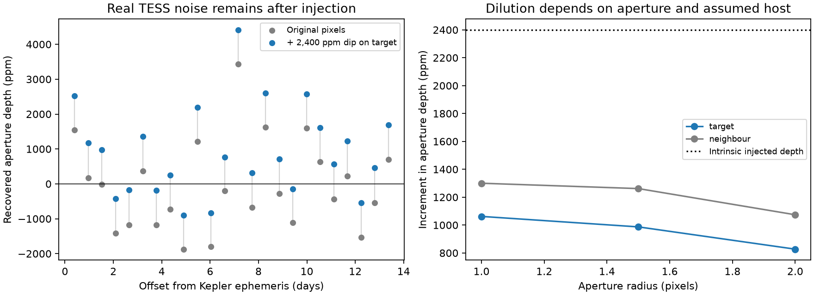
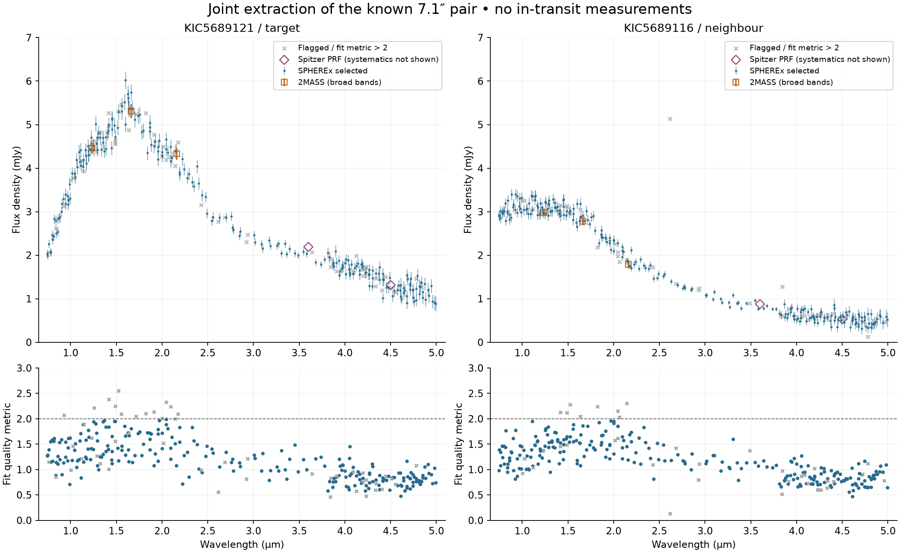

# Second archive pass — 12 October 2026

This continues, and supersedes the coverage limits in, `../archive-followup-20261012/`. The first pass stopped too early. Service errors are not empty searches. This pack records additional data found through current browser interfaces, bulk catalogues and alternate archive services. It does **not** establish a confirmed planet or change the saved FPP (0.06885).

## What the Chrome search established

The NASA Exoplanet Archive Inventory position search at 285.907827°, +40.941988°, radius 30″ works after pop-ups are allowed. It returns two 2MASS sources and 13 Kepler time series (53,923 points) for **KIC 5689116**, the 7″ neighbour. There are no confirmed-planet, TOI, KOI or TCE rows in that cone. This is an inventory of selected archive holdings, not every observation of that sky position.

Its legacy IRSA `nph-estimation` link returns 404. The current [IRSA homepage](https://irsa.ipac.caltech.edu/) Search for Source leads to `nph-discovery`, which returns **62 dataset matches**. `planethunt-irsa-62-datasets.tbl` is the complete browser-downloaded inventory. These are dataset collections, including overlapping releases and coarse all-sky maps; they are not 62 independent observations or 62 high-resolution images. The export exposes ZTF, PTF and NEOWISE data not examined in the first pass.

The old MAST portal stayed blank in Chrome. The [current MAST interface](https://mast.stsci.edu/search/ui/) works. The Hubble search within 5′ returns **11 WFC3 records** centred on GRB230818A; `hst_browser_5arcmin.csv` is the downloaded table. Their coordinates put them approximately 2.85–4.02′ away. The displayed/exported angular-separation unit is inconsistent with the numerical values: calculate from RA/Dec rather than assuming the column label. ESA's HST footprint query at the exact target returns zero rows. The current MAST JWST search within 5′ returns ten NIRSpec products for GRB230818A and its reference star (`jwst_browser_5arcmin.csv`); these are nearby pointings, not a target detection. The ESA JWST ObsCore footprint query at the exact target returns zero rows. These are successful empty footprint queries, not timeouts.

## New photometry and what it tells us

| Data | Actual check | Result / limit |
|---|---|---|
| **TESS-Gaia Light Curve (TGLC)** | Six sectors (14, 26, 40, 41, 53, 54), target and neighbour; all four raw/calibrated PSF/aperture columns; 12 predicted windows; both flags zero | Target calibrated PSF depth **450 ± 1,793 ppm**; raw PSF **789 ± 1,783 ppm**. No convincing recovery. |
| **ZTF DR24** | 2,068 downloaded measurements in four target source IDs; quality flags zero; independent source/100-day baselines; UTC-to-BJD_TDB conversion | Combined fixed-window depth **1,780 ± 6,141 ppm**, 14 in-window points among 1,843 accepted measurements. Off-phase depths scatter by **9,486 ppm**. No detection or useful exclusion of a ~2,400 ppm transit. |
| **PTF** | 24 target measurements, barycentric timing checked | **Zero** points in the nominal 2.3-hour transit windows; closest is **13.97 h** from a predicted midpoint. Median uncertainty 0.0305 mag. No transit test. |
| **NEOWISE-R** | 514 measurements within 5″; artifact flags and frame-quality screening | 475 accepted per band, just **3** nominal in-transit samples. Median errors **0.029 / 0.058 mag** in W1/W2. Global-baseline contrasts are consistent with zero; blending and systematics preclude a shallow-transit constraint. |

TGLC uses the same TESS photons as the earlier aperture check, not an independent observation. Its pipeline models neighbouring light using Gaia. The target and neighbour calibrated PSF series still correlate from 0.05 to 0.92 by sector; neither a pipeline label nor those correlations prove correct separation of the variable flux. These TGLC checks are not themselves a pixel-level injection/completeness experiment; the separate conditional experiment below tests the aperture extraction. The [TGLC archive documentation](https://archive.stsci.edu/hlsp/tglc) explains that sectors 12–55 are not all indexed in the usual MAST searches; the bulk files were essential. See DOI [10.17909/610m-9474](https://doi.org/10.17909/610m-9474).

Uncertainties in the local TESS estimator include baseline fitting, a 30-minute correlated-noise factor and between-event scatter. ZTF errors include residual-scatter inflation; phase controls demonstrate that even these formal uncertainties do not capture every systematic. Off-phase controls are diagnostics, not planet probabilities. All checks use the saved Kepler period and epoch; ±60-minute TGLC timing checks are saved without optimizing a new ephemeris.

## Conditional TESS pixel-injection test

`analyze_pixel_injection.py` now injects a source-specific decrement into all ten saved TESS pixel cubes, re-estimates each affected cadence’s sky background, repeats the three aperture extractions and applies the same local transit estimator. It uses 33 published TESS PRF files, bilinearly interpolated on the detector using [Keaton Bell’s TESS_PRF](https://github.com/keatonb/TESS_PRF); its MIT-licensed interpolation code and upstream commit are retained. Gaia positions are propagated to each sector’s approximate epoch. The box transit is integrated over the cadence duration.

The assumed target TESS magnitude is 15.2979 from the TGLC header; neighbour 14.9996. Fluxes use the [TESS zero point of 20.44](https://tess.mit.edu/public/tesstransients/pages/readme.html). **This is a catalogue-based flux assumption, not a newly measured deblended flux.** Tests at half and twice the target flux are retained.

A 2,400 ppm intrinsic target dip produces nominal aperture-depth increments of **1,062 / 987 / 827 ppm** for radii **1 / 1.5 / 2 pixels**. At radius 1.5, halving/doubling the assumed target flux produces **493 / 1,974 ppm**. Across 24 off-phase trials, the median increment is **987 ppm**, while the original depth scatter is **1,294 ppm**. One trial exceeds positive 3σ both before and after injection; that count is not a calibrated detection probability. The two stars’ PRF templates correlate **0.868–0.961**, illustrating the difficult separation.



This closes the earlier gap between simply multiplying the extracted light curve and injecting light at a particular source position. It still assumes a fixed PRF within a sector, an estimated source brightness and a box-shaped transit. It does not refit a time-dependent scene, simulate pointing jitter, run a blind transit search or establish completeness. It explains why these TESS apertures have weak power to reject this shallow candidate; it does not confirm the transit or its host.

The separately extracted **ZTF neighbour** series also gives no signal at the predicted ephemeris: **−1,116 ± 2,767 ppm**, with off-phase scatter **4,062 ppm**. The negative depth indicates a noise-consistent brightening, not an eclipse. It cannot by itself rule out the neighbour at the relevant shallow depth.

## Early WISE epochs and the catalogue SED

An additional **28 four-band-era and 50 post-cryogenic WISE measurements** were retrieved at the target position. All 78 W1/W2 measurements pass the chosen artifact/photometric-quality screen; **none falls in the nominal transit window**. The nearest predicted midpoint is 84 h away for the first set and 98 h for the second. This fills in early epochs absent from the NEOWISE-R screen.

The AllWISE source J190337.86+405631.1 lies 0.165″ from the query position: **W1=12.909 ±0.025**, **W2=12.853 ±0.026**, with quality **AAUU**. W3=12.492 and W4=8.948 are **upper-limit magnitudes**, not detections. These profile-fit values differ from the single-exposure medians; blending and differing reductions prevent interpreting that difference alone as intrinsic variability. Do not fit a stellar SED treating all reductions as independent precise measurements.

`irsa_dataset_triage.json` accounts for every one of the 62 browser inventory entries and distinguishes processed data, overlapping releases, and products unsuitable for the close-companion question. No claim is made that every listed image has been re-reduced.

## SPHEREx: a new infrared spectrum for each star

The browser inventory returned **288 spectral-image footprints**. A joint two-point-source run in the official [SPHEREx spectrophotometry tool](https://irsa.ipac.caltech.edu/onlinehelp/spherex/spherex/sp.html) completed on 12 October 2026 after about 15 minutes. Both Gaia positions were propagated to the median image epoch, 2025.7546; the exact inputs and sanitized job provenance are retained. The result has **287 measurements per star**, from **0.744 to 4.992 μm**, observed April 2025–May 2026. Footprint matches and successful extracted measurements are different counts.

The target has **249** measurements without the selected bad flags; the neighbour has **254**. Adding an exploratory `fit_ql <= 2` screen retains **238 / 249**. This threshold is our choice, not an official acceptance rule. The full flag mask and sensitivity to thresholds 1.5, 2, 2.5 and 3 are saved. SOURCE (bit 21) and FULLSAMPLE (bit 12) are informational and are not rejected. Median reported fractional errors in the selected points are **3.94% / 4.61%**. These errors are not a complete calibration or deblending uncertainty budget.



The broad spectral shapes and levels are visually consistent with the resolved 2MASS and exploratory Spitzer photometry. The target becomes substantially brighter than the neighbour in the infrared. This is useful input for a joint stellar/extinction/multiplicity fit, **not evidence that the star is single or that a planet atmosphere has been measured**. Broad-band points are shown at reference wavelengths, not synthetic bandpass-integrated predictions; no statistical cross-survey agreement or variability claim is made. 2MASS uncertainties use `*_msigcom` plus separately propagated zero-point errors from the [official calibration FAQ](https://www.ipac.caltech.edu/2mass/releases/allsky/faq.html). Spitzer points retain the earlier reduction's calibration limitations.

**No returned measurement is in the nominal transit window**; the closest is 3.38 hours from a predicted midpoint. Timing uses an approximate geocentric barycentric correction. No independent transit was recovered, and FPP remains unchanged. Joint fitting mitigates the known 7.1″ blend but cannot resolve the much closer hypothetical companion. The viewer loaded both spectra, but its image previews returned “Service Unavailable”; image-level residual inspection remains incomplete. The original VOTable, all measurements, selected/rejected labels and quality summaries are saved. Astropy rejected the service's multidimensional string-array format, so the script reads numeric XML TABLEDATA explicitly and verifies array lengths without altering the original file.

## CFHT image: useful, with a real limitation

CADC records four MegaCam exposures and a MegaPipe stack footprint at this position. One public 2009 r-band processed cutout, **1098087**, was retrieved (320.17 s; 0.185″/pixel). Its header explicitly lacks a solved astrometric calibration. Matching 18 bright Gaia field stars gives an approximate translation of **−91.49, −59.56 pixels**, with 1.22-pixel RMS. This registration identifies the target and 7.1″ neighbour; using the original WCS without checking would point to the wrong pixels.

Both stellar cores reach the same clipped image maximum near the saturation limit. `cfht_pair.png` and `cfht_quality.json` document this; the Moffat FWHM fits are only image-quality diagnostics on clipped profiles. **No validated close-companion contrast curve is derived from this image.** Other public processed/stack cutout requests returned file-not-found; the 2025 exposure returned permission denied. Their error bodies and request provenance are retained. A broad metadata footprint alone is not evidence of usable pixels or sensitivity to an unresolved companion.

## A previously missed literature connection

The exact Gaia source **2103792461826460288** appears in Table 5 of [Barber et al. 2022, THYME VIII](https://arxiv.org/abs/2206.08383), in the candidate list for MELANGE-3:

- Tangential velocity offset: **0.795 km/s**.
- Colour-assigned spectral type: **M1.6** (not a measured spectrum).
- Parallax: **3.406 ± 0.040 mas**.
- Kepler light-curve flag: **Y**; TESS flag: **N** under that paper's quality criteria.
- No listed rotation period, lithium measurement or radial velocity for this source.

The association age is about 105 ± 10 Myr, but this star's membership is **not established** by being in the initial candidate list. The paper explicitly discusses substantial field contamination. Do not assign that age to the star or change the planet parameters on this basis. Section 3.3 says the Kepler curves used were PDCSAP, while our inventory returns the nearby KIC 5689116. The association between the Gaia row and an actual light-curve file therefore needs reconciliation. The flag is not proof this deblended signal was previously examined, and it prevents an unqualified “never searched” claim. This creates a specific expert-review question: what light curve was associated with the star, was its 13.77-day signal examined, and can membership be assessed? The paper searches for planets; its listed planet-host discussions do not identify KIC 5689121/TIC 120686465.

The raw CDS table is retained because a VizieR coordinate query applied an unexpected epoch/equinox transformation and missed the row. Exact-string matching in the published table recovered it. A blank query is not sufficient until the identity and coordinate convention are checked.

## Service failures and remaining limits

For the repeated legacy MAST API failures, TCP and TLS connections completed and certificate verification passed; no response body arrived before 55 seconds. That identifies a response timeout, **not its underlying server-side cause**. The current browser UI and ESA footprint service provide alternate checks. NEOWISE's Gator route eventually succeeded even though a separate TAP request timed out.

The selected APOGEE DR17, LAMOST DR7/DR9/DR10 and Kepler imaging-compilation queries are retained. Empty results apply to the queried products only; catalogue names and epochs matter. An initial probe aimed at an incorrectly identified Robo-AO catalogue was discarded. The corrected 30″ J2000 cone searches of all four Robo-AO Kepler survey catalogues—J/ApJ/791/35, J/AJ/152/18, J/AJ/153/66 and J/AJ/155/161—return no rows. These catalogue non-matches do not exclude unpublished imaging or sensitivity outside their selection.

Still uncompleted: a calibrated, time-dependent TESS scene fit and blind-search completeness analysis; a trustworthy unsaturated CFHT/MegaPipe product or empirically calibrated companion limits; a joint stellar/multiplicity fit; a complete audit of unindexed or proprietary imaging. None can honestly be labelled exhausted by these checks. No outreach has been sent.

## Reproduction and provenance

`requests.json` records exact URLs, query parameters, UTC access times, return codes and selected transfer diagnostics. Successful raw responses, failed-request bodies where available, downloaded FITS light curves and Chrome-exported tables are retained. The very large CADC all-mission response is gzip-compressed. The filenames ending `.body` preserve download content; successful TGLC and CFHT files are FITS, catalogue responses may be CSV/VOTable/TSV.

Run with the dependencies in the preceding archive-followup pack:

```
python analyze_tglc.py
python analyze_ztf.py
python analyze_ztf.py --neighbour
python analyze_pixel_injection.py
python analyze_cfht.py
python analyze_sparse.py
python analyze_early_wise.py
python analyze_spherex_inventory.py
python analyze_spherex.py
```

These are exploratory analyses with explicit assumptions, not validation pipelines. The period and epoch reproduce `../archive-followup-20261012/spitzer/kfit_psf.json`. No fitted astrophysical probability has been recomputed.

The current [follow-up plan](../archive-followup-20261012/FOLLOWUP_PLAN.md) incorporates these results and the newly identified literature contacts. The [reply to Steve](reply-to-steve.txt) is a draft only; no message was sent.
