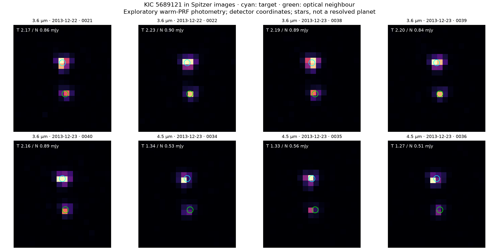

# Archival follow-up — 12 October 2026

**Status: unconfirmed.** This extends the 11 October validation record. The new infrared measurements describe the stars, not the planet. They do not supply an infrared transit, a close-companion contrast curve, or a revised false-positive probability. The saved TRICERATOPS result remains **FPP 0.06885**.

## What the new Spitzer images tell us

IRSA returned eight calibrated exposures covering KIC 5689121, taken on 22–23 December 2013 in programme 10067 (PI Michael Werner; AORs 50050048 and 50057216). The 7.1″ optical neighbour is clearly separated. The candidate host is about 2.5 times brighter than that neighbour in these infrared bands, reversing their optical brightness ordering.

| Quantity | IRAC 3.6 μm | IRAC 4.5 μm |
|---|---:|---:|
| Exposures | 5 × 10.4 s | 3 × 10.4 s |
| Target, two-source PRF fit | 2.190 mJy | 1.313 mJy |
| Target, corrected 2-pixel aperture | 2.066 mJy | 1.327 mJy |
| Target, corrected 3-pixel aperture | 2.073 mJy | 1.329 mJy |
| Neighbour, two-source PRF fit | 0.877 mJy | 0.532 mJy |
| Neighbour, published SpiKeS catalogue | 0.864 mJy | 0.548 mJy |

Extra digits make the calculations auditable; they are **not** measurement precision. Report the target conservatively as approximately **2.1 and 1.3 mJy**. The ~6% spread between methods at 3.6 μm is larger than the frame-to-frame scatter. The published neighbour photometry is a useful reduction cross-check, but uses the same underlying survey and is not an independent observing epoch.



**None of these exposures catches a predicted transit.** Using the preserved Kepler ephemeris, the 22 December frames are +3.14 hours from mid-transit; the 23 December frames are +20.04–20.08 hours. The full transit lasts about 2.1–2.4 hours. The propagated ephemeris uncertainty at this epoch is only minutes. These short visits cannot test an infrared transit depth or update the orbital period.

## Reduction and checks

- Preserved all eight CBCD images, matching uncertainty images and both bit-mask products, their archive URLs and SHA-256 hashes. The selection is the calibrated, full-array frames returned by a 1″ SIA cone at the target, not every frame from these AORs.
- Fit two stars plus a background plane, using the official warm IRAC PRFs, bilinearly interpolated across their 25-position detector grids. Positions may move by up to 1.5 native pixels from their WCS seeds. Source separation is 7.06–7.16″.
- Converted MJy/sr using the WCS pixel solid angle. The oversampled PRFs are sampled as pixel-response tables, at five PRF samples per detector pixel. Explicitly normalized the sampled zero-phase PRF to a 10-native-pixel aperture; the supplied FITS amplitudes cannot simply be interpreted as unit-flux fit templates. This convention and aperture comparisons are visible in the code.
- Excluded BIMSK bits 3 and 8–14, and nonzero BRMSK pixels. Repeated fits excluding *all* BIMSK flags and with a 5-pixel rather than 7-pixel fit radius. Mean fluxes change by less than 1%. One 4.5 μm neighbour aperture intersects bad pixels and is excluded from aperture averages.
- Independently measured exact-overlap apertures of radius 2 and 3 native pixels, with a clipped 12–20 pixel sky annulus and the published warm aperture corrections. Masked the other star from the background annulus.
- Inspected image and residual panels. The 4.5 μm residuals retain structure; these are not high-contrast residual images suitable for excluding subarcsecond companions.
- Approximate mid-exposure BJD_TDB uses header BMJD_OBS, ET_OBS−UTCS_OBS and half FRAMTIME. The archive barycentric correction refers to the frame direction, not a newly computed target-specific correction; the difference is immaterial for this out-of-transit classification.

No extra array-location, aperture pixel-phase or colour correction is applied. No injection/recovery completeness or unresolved-binary likelihood is inferred. Formal fit errors condition on fitted positions; reported scatter and SEM omit shared calibration and model errors. Existing unresolved 2MASS/WISE photometry and these images do not establish that the target is a single star.

[Residual panels](spitzer/results/spitzer_residuals.png) · [Per-frame measurements](spitzer/results/per_frame.csv) · [Machine-readable summary](spitzer/results/summary.json) · [Provenance](spitzer/provenance.json)

## Archive audit and its boundaries

The [initial audit](archive/initial-audit.txt) preserves the exact queries and their raw responses. [Additional probes](archive/additional-probes/) repair or extend several of those searches.

| Search | Result | What it does / does not establish |
|---|---|---|
| NASA Exoplanet Archive, exact identifiers across KOI/TCE/stellar/planet/TOI/Kepler products | No target records in the queried tables | No catalogue recognition found; not proof of novelty or absence of all data |
| 5′ archive neighbourhood | Kepler-169 and false-positive KOI-3784.01 | These are different stars |
| ExoFOP target and bright neighbour | No uploaded imaging, spectra or time-series files | Upload coverage is incomplete |
| Full published SpiKeS catalogue | Target absent; neighbour present | Catalogue absence did not mean image absence; target photometry now extracted above |
| Gaia DR3 exact source | RUWE 0.9841; excess-noise significance 0; duplicated_source false; ipd_frac_multi_peak 0; non_single_star 0 | No obvious catalogue astrometric warning, but no exclusion of an unresolved companion |
| Gaia DR3 two-body orbital solutions | Zero rows | No published orbit in this table; not a binary exclusion |
| Keck legacy 30″ NIRC2 footprint search | No target products | Wider legacy query failed; replacement TAP queries succeeded |
| Keck TAP, rectangle enclosing 5′, NIRC2/HIRES/NIRC/NIRSPEC/OSIRIS | 13 NIRC2 + 2 HIRES records near Kepler-169; zero in other three instruments | All NIRC2 records name KOI-0505, use narrow 5.1″ or 10.2″ fields, ~263″ away; they do not cover this target |
| Gemini, 5′ pointing cone | Empty result | No records returned in this query, not an all-instrument footprint proof |
| MAST general inventory, GET and filtered POST | Timeouts | HST/JWST inventory unresolved; this is not a negative result |
| TESScut sector service | All ten sectors downloaded and reduced | 62,082 usable cadences; 20 predicted windows; no convincing aperture recovery, and insufficient sensitivity for a rejection |

The fresh Gaia parallax is **3.40648 ± 0.03973 mas**. It has not been zero-point corrected or incorporated into a joint stellar fit. We do not silently replace the older adopted ~298 pc estimate or recompute planet properties from its reciprocal.

This is a bounded, reproducible audit, **not a claim that every archive is exhausted**. Unindexed/proprietary observations, other observatories and MAST inventory failures remain possible. The raw failures are retained alongside successful null results.

## TESS and the observing route

The [TESS reduction](tess/README.md) checks all ten returned sectors with fixed apertures, timing offsets and shifted-epoch controls. It does not provide a new confirmation or a calibrated exclusion. The [follow-up plan](FOLLOWUP_PLAN.md) gives an observer-ready target card, contacts, the current NASA-Keck eligibility/deadline situation, and the measurements needed to address the unresolved-host branch.

## Reproduce the Spitzer measurement

From the repository root, use Python 3.12 and the pinned [requirements](scripts/requirements.txt):

```sh
python3.12 -m venv /tmp/planethunt-irac-env
/tmp/planethunt-irac-env/bin/pip install -r analysis/archive-followup-20261012/scripts/requirements.txt
OPENBLAS_NUM_THREADS=1 OMP_NUM_THREADS=1 /tmp/planethunt-irac-env/bin/python analysis/archive-followup-20261012/scripts/analyze_spitzer.py
```

The analysis runs offline on the committed data. Outputs go to `spitzer/results/`; `--out` can select a temporary destination. [download_inputs.py](scripts/download_inputs.py) restores missing inputs and checks their hashes. The original Kepler `kfit_psf.json` is copied byte-for-byte for the timing calculation.

## Primary documentation

- [IRSA SIA service](https://irsa.ipac.caltech.edu/ibe/sia.html), [SpiKeS catalogue](https://exoplanetarchive.ipac.caltech.edu/docs/spikes.html).
- [Official warm PRFs](https://irsa.ipac.caltech.edu/data/SPITZER/docs/irac/calibrationfiles/psfprf/), [aperture corrections](https://irsa.ipac.caltech.edu/data/SPITZER/docs/irac/iracinstrumenthandbook/17/).
- [IRAC time keywords](https://irsa.ipac.caltech.edu/data/SPITZER/docs/irac/iracinstrumenthandbook/32/), [bit masks](https://irsa.ipac.caltech.edu/data/SPITZER/docs/irac/iracinstrumenthandbook/34/).
- [Gemini archive API](https://archive.gemini.edu/help/api.html), [Keck NIRC2](https://www2.keck.hawaii.edu/inst/nirc2/), [TESScut API](https://mast.stsci.edu/tesscut/docs/getting_started.html).

This work uses Spitzer Space Telescope observations and calibration products hosted by IRSA at IPAC/Caltech, NASA Exoplanet Archive/SpiKeS data, ESA Gaia DR3, and public Keck/Gemini archive metadata. Consult each archive's publication acknowledgement requirements before a manuscript submission.
