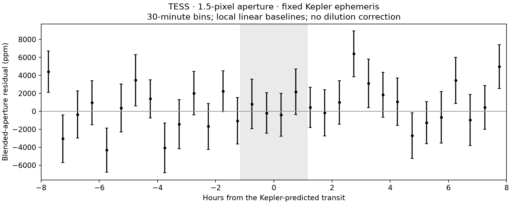

# Technical audit of the submitted note — 13 October 2026

This audit of manuscript AAS82222 addresses the selection, other search outcomes, TESS non-detection and Barber catalogue reference. It does not validate the candidate or establish a publication-ready revised analysis. The original submitted manuscript and DOI-backed release remain unchanged; this is a subsequent correction record.

## 1. Sample construction reproduced

The starting sample was **the published Kepler Bonus v1.0 M-star catalogue**, not a new all-sky Gaia query. Martínez-Palomera et al. (2023), section III.2 and appendix F, describe its selection using Gaia/WISE/2MASS photometry where available and Gaia temperature information. These are catalogue-selected potential M dwarfs, not 29,800 spectroscopically verified M dwarfs. The parent catalogue inherits Kepler pixel coverage and extraction selection.

Fresh MAST M-star and full-source catalogue downloads match the SHA-256 hashes recorded before submission. Joining by exact Gaia designation and applying the documented cuts reconstructs the preserved eligible-source list exactly:

| Cumulative selection | Sources |
|---|---:|
| M-star catalogue; all present in full-source catalogue | 29,800 |
| Catalogue minimum PSFFRAC > 0.5 | 9,204 |
| Catalogue minimum CROWDSAP > 0.7 | 6,477 |
| At least 8 available PSF quarters (ones in `psf_avail`) | 2,495 |
| KIC differs from originating target-pixel-file KIC (`kic != tpforg`) | 1,836 |
| Exclude primary targets using preserved exclusion table | 1,800 |

The final exclusion uses `mstar_primary_exclusion_check.csv`; this audit does not claim a fresh re-query of the complete primary-target catalogue. Sorting by ascending Gaia G then Gaia designation exactly reproduces the first 64 pilot targets in order. Catalogue quarter availability is distinct from the later requirement for at least six usable quarters after cadence/quarter screening. This reconstructs selection; it does not measure detection completeness or independently prove when every historical choice was made.

The pilot reserves the last `max(2, ceil(0.25 * N))` usable quarters. It independently cleans discovery and reserved subsets. It searches 0.5–25 days, with up to two peaks per star. First-screen requirements are BLS SNR >= 9, at least three good events in each subset, held-out SNR >= 4, odd/even difference < 3 sigma, secondary significance < 3, and maximum single-event contribution < 0.5. The assumed search density is 5 solar, not a measured stellar density.

## 2. Search extension and controls are separate operations

Extending the search means moving down the same ranked source list. Inverting means running the same source through the same processing with normalized flux `f -> 2 - f`; dimmings become brightenings. The same usable data and quarter split are retained. Inversion does not itself extend the target sample. The extension notes also contain a post-hoc stricter screen excluding 12.5–14.5 days; that screen was chosen after inspecting results and cannot be presented as an independent validation of this 13.77-day candidate.

| Stage | Sources searched per polarity | Real passing signals / stars | Inverted passing signals / stars |
|---|---:|---:|---:|
| Initial 64 | 64 | 2 / 2 | 0 / 0 |
| Ranks 65–576 | 497 | 10 / 9 | 10 / 9 |
| Ranks 577–1800 | 1,175 | 19 / 18 | 22 / 19 |
| Total | 1,736 | 31 / 29 | 32 / 28 |

The extension skipped 63 sources with insufficient usable quarters and one download timeout. Thus 1,800 selected is not 1,800 searched. Counts above are recomputed from the saved tables; this audit does not rerun all historical BLS searches.

**No planet has been validated by this search, including KIC 5689121.** The other pilot pass, KIC 10794841 at 1.4102 days, had secondary dimming and weak aperture support. The extension contains known-period contamination matches, polarity-symmetric signals and unresolved leads, including KIC 6629201. Several have never received source localization. Their absence from the main candidate discussion does not prove that they are all nonplanetary.

At the additional retrospective cuts P > 1.5 days, BLS SNR >= 26.7 and held-out SNR >= 15.5, two inverted stars survive: KIC 8701308 and KIC 5283912. This is different from the 32 ordinary first-screen inverted signals. The original SCIENCE.md interpretation of 2/1,736 as an empirical false-alarm rate has been corrected: the count is descriptive, not a calibrated false-alarm probability. The extension's depth-only planet exclusions have also been removed.

## 3. TESS was folded; it does not show a detection

The ten-sector aperture analysis was rerun from the preserved TESScut pixels in a fresh Python 3.12 environment. The summary, event table and sector table reproduce **byte-for-byte**. The six-sector TGLC analysis was also rerun, reproducing all saved summary values. Repeating the same algorithms tests reproducibility, not independent validity.

The fixed ephemeris is P = 13.769448251493595 days and T0 = -1369.7545693539214 BTJD (BJD_TDB - 2457000). The extraction uses quality-zero finite cadences, fixed circular apertures, a faint-outer-pixel background estimate, and linear baselines within ±0.5 days of each event, excluding ±0.12 days. The nominal box duration is 2.3 hours. Baseline outliers, not in-transit points, are clipped. Timing offsets of ±30 and ±60 minutes were checked without choosing a new best ephemeris.

| Extraction | Usable event windows | Dimming depth (ppm) | Reported diagnostic error (ppm) | Off-phase depth scatter (ppm) |
|---|---:|---:|---:|---:|
| 1-pixel aperture | 20 | -483 | 958 | 1,189 |
| 1.5-pixel aperture | 20 | -1,221 | 1,236 | 1,490 |
| 2-pixel aperture | 20 | -2,075 | 1,384 | 1,762 |
| Target TGLC calibrated PSF | 12 | 450 | 1,793 | 2,578 |

Positive values mean dimming. These correlated extractions must not be multiplied as independent evidence. None recovers the transit convincingly. The negative aperture estimates must not be hidden by presenting only the positive TGLC estimate.



The separate **previously saved** conditional PRF injection predicts a ~987 ppm increment in the 1.5-pixel aperture for an assumed 2,400 ppm intrinsic target dip. Its 24 phase trials have 1,294 ppm uninjected scatter. These are a different control grid from the 80 trials in the table. Target brightness and PRF are assumptions; the experiment does not fit a time-dependent scene or calibrate a blind-search recovery probability. That pixel-injection script was inspected here but not rerun in this audit. A small response relative to noise is a reason to investigate sensitivity, not grounds to declare the TESS concern settled.

Still needed: independently checked timing conventions and full joint period/epoch uncertainty propagation; a realistic transit/template and source-flux treatment across the Kepler/TESS passbands; calibrated injection/recovery under correlated noise; and extraction/systematics sensitivity. The ±60-minute checks are not a substitute for ephemeris posterior propagation. No updated FPP or quantitative TESS exclusion is claimed.

## 4. Barber electronic table match verified

A fresh CDS download of Barber et al. (2022), AJ 164, 88, **electronic Table 5**, contains this exact row at line 546:

```text
2103792461826460288 285.90783 40.94199 16.282 0.795 M1.6 N Y 3.406 0.04
```

The ReadMe labels the identifier **Gaia EDR3**, coordinates J2016, and the two flags TESS then Kepler. Thus TESS=N and Kepler=Y. The flags mean sufficient light-curve quality for the authors' Notch search. This is a precise electronic-catalogue reference, not a claim that the ID is visible in the printed paper's abbreviated table. No rotation period, lithium or radial velocity is given in this row.

The row establishes a catalogue connection, not confirmed association membership, youth, a previous detection, or the exact Kepler light curve assigned to the source. That identity still needs the authors' clarification.

## Sources and reproduction

- [Kepler Bonus paper, sections III.2 / appendix F](https://arxiv.org/html/2310.17733v1) and [MAST catalogue documentation](https://archive.stsci.edu/hlsp/kbonus-bkg).
- [Barber electronic table](https://cdsarc.cds.unistra.fr/ftp/J/AJ/164/88/table5.dat), [column definitions](https://cdsarc.cds.unistra.fr/ftp/J/AJ/164/88/ReadMe), [paper DOI](https://doi.org/10.3847/1538-3881/ac7b28).
- `verification.json`: catalogue hashes, reconstructed counts, control thresholds, rerun hashes and exact Barber row.
- `verify.py`: offline verification against downloaded catalogues and separately rerun outputs; `requirements.txt` pins the audit environment.

Download the two MAST catalogue URLs recorded in `verification.json` as `mstars.fits` and `source-catalog.fits`, and the CDS table as `table5.dat`, into a scratch directory. Use the prescribed downloader User-Agent `OpenAI File Downloader, XaiImageApiFetch/1.0`. The catalogues are not duplicated in this repo. Run `analyze_tess.py --out <scratch>/tess-rerun`. For TGLC, copy its unchanged script into `<scratch>/tglc-rerun/` and link the preserved `tglc_correct_*.body` inputs beside it; its outputs then remain outside the original evidence directory. Finally run:

```sh
python analysis/editorial-audit-20261013/verify.py --repo . --downloads <scratch> --reruns <scratch> --out <scratch>/verification.json
```

This audit narrows the factual disagreements and corrects overstatements. It does not resolve TESS sensitivity, every other lead, or the candidate's physical nature.
